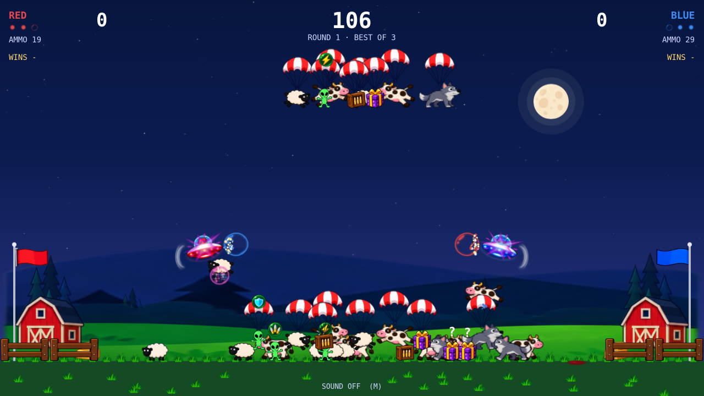
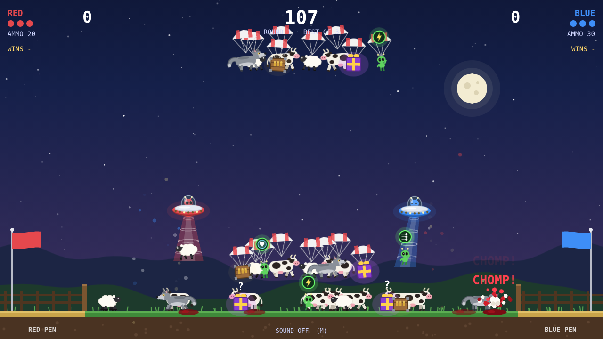

# Pre-merge production playtest

The production runtime from `phaser` commit `044ed44` passes this playtest.
On October 13, 2026, the user confirmed smooth M1 MacBook Air Safari gameplay
in both cartoon and classic graphics, including ordinary/busy play and changing
graphics while paused. That confirmation is recorded in [manual.json](manual.json).
No new numeric M1 timing measurements were supplied.

The cloud checks use the actual production build and Chromium with ANGLE
SwiftShader or Canvas. The [summary](summary.json) and detailed reports separate
this automation from the user's physical-device confirmation:

| Check | Result | Evidence |
| --- | --- | --- |
| Ordinary and busy gameplay, both styles and both renderers | Eight live cases pass, with no runtime/console errors or halted game | [live.json](live.json) |
| Artwork coverage and seasonal scenery | 28 gallery and 12 seasonal cases pass | [sprites.json](sprites.json) |
| Settings persistence and paused style changes | 25 switches per renderer preserve round/session identity, paused state and resource/listener counts; play resumes | [sprites.json](sprites.json) |
| Production hosting and complete match flow | Six routing cases, eight root/subdirectory and renderer/DPR cases, and 80 completed-match ownership cycles pass | [production.json](production.json) |

Each live case records 12 seconds after two seconds of warmup. Ordinary play
uses scripted movement and shooting. The combined case exercises repeated animal,
powerup, wolf and ammo-crate arrivals alongside shooting, hooking, pickups,
interruptions and falling objects. Every combined case produces 16 new animals,
eight drops, four wolves and four crates, with actual hook/combat/landing events.
The game stays on the same live round throughout each sample. All eight gameplay
captures were visually inspected; no missing artwork or rendering defects were
observed in those captures.

The production application and its assets load from the preview server. The live
runner imports the existing `performance.js` helper and pure-logic fixture builders
from a separate local source server; these provide scripted activity and
measurement, not a replacement application. The other checks use the bundled
production scenes and DOM input. Reports retain source and production-artifact
hashes. No application code, game rules, graphics or dependency versions changed.

Cloud timing is diagnostic: software-GPU callback/CPU measurements do not establish
M1 Safari frame pacing. The live runner disables sound for its graphics samples;
this run does not repeat audible-sound or physical-controller acceptance. Those
earlier acceptances remain recorded in the cutover notes. This is a short
production playtest, not a new long-session soak or cross-browser sweep. The
existing browser/input advisories and documented rare benchmark stalls remain
follow-ups rather than new gates.

To repeat the ordinary production checks:

```sh
npm run build
npm run preview -- --host 127.0.0.1 --port 5200 --strictPort
python scripts/phaser/check_sprites.py --base-url http://127.0.0.1:5200/
python scripts/phaser/check_production.py --browser-executable /usr/bin/chromium --software-gpu
```

For a manual playtest, use that production build on the M1 in Safari. Compare
ordinary and busy play in both styles, and change **Classic graphics** in the
pause menu. Optional review URLs `?graphics=cartoon` and `?graphics=classic`
select a style without changing the saved preference.




