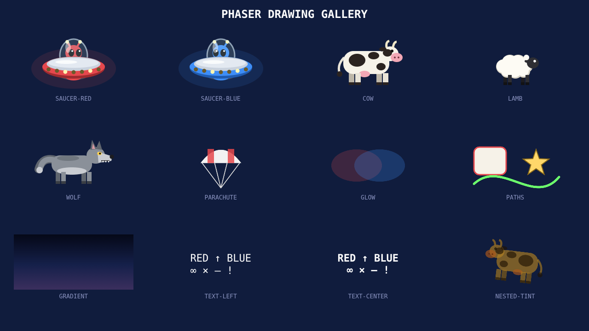

# Milestone 2: drawing and resource ownership

Implemented on `phaser`, following the security fix `ac40db7`. The full game
continues to use Pixi by default. Milestone 3 has not started.

Run `npm ci` and `npm run dev`, then open
`http://localhost:5173/?engine=phaser&gallery=primitives` using Vite's printed port.
Dismiss the startup overlay. V toggles 16:9; add `&renderer=canvas` to check Canvas.
The existing host calibration remains at `?engine=phaser`.



Compare [the real Pixi reference](pixi-gallery.png) and
[Phaser Canvas](canvas-gallery.png). The gallery uses fixed normal poses at
1.25 seconds. The saucer/animal/wolf/parachute references come from the unchanged
Pixi view factories; the new Phaser recipes are independent. Original frozen
references in `baselines/pixi/` are untouched.

## Drawing decisions

`src/phaser/presentation.js` constructs native Phaser Containers, Images, Text,
and Graphics. `drawing.js` and `shapes.js` provide focused Canvas path recipes,
with explicit bounds and offsets. Ellipses take radii; polygons, rounded rectangles,
stars, quadratic/cubic curves, line widths/caps, fill/stroke order, and negative
coordinates are checked against Pixi. The representative animal parts preserve
their original child order, including far legs, body, and near legs.

Each fill or stroke is a separate shared texture-backed Image. This preserves
the original per-paint blending under container alpha: baking an entire compound
body into one image changes translucent overlaps. Shape textures use resolution
4 to keep the gallery's 2x artwork sharp at DPR 2. Shared paths are generated once;
`createDrawing` IDs must identify an immutable recipe, including any style variants.
This establishes fidelity and ownership; full-game texture/atlas and draw-call
optimization remains subject to measurement in later milestones.

The sky is a procedural Canvas texture with the original three stops at 0, 0.55,
and 1, including its padded negative bounds. It uses resolution 1. Phaser's
four-corner Graphics gradient cannot reproduce this recipe, and its Canvas-based
`generateTexture` does not bake the WebGL gradient.

Labels retain monospace, original sizes/colours/boldness, Unicode, multiline
alignment, and resolution 2. Font metrics use Pixi's `|ÉqÅM` measurement string.
Checks compare live Pixi metrics in the same browser/DPR: Chromium's hinted font
height varies with DPR. Phaser rounds text widths upward by less than one logical
pixel; a centred origin can move a glyph edge by less than half a logical pixel.
The image checks bound those differences to the reference's edge band.

Use `scope.tint(node, colour)` for managed images, labels, and containers. Phaser's
native `setTint` is WebGL-only; the helper multiplies RGB into cached texture
variants for both renderers and preserves alpha. Reparenting recomputes inherited
tint. Native Graphics are for untinted UI rectangles; tinted artwork uses the
managed drawing recipes. Camera viewport clipping remains the host's responsibility
and works in both renderers; no per-view masks are allocated.

The gallery found a pinned-version WebGL bug: Phaser 4.2.1's multi-texture sampler
compares interpolated texture IDs with exact floats. Rotated quads lost interior
pixels on SwiftShader. `textureSampling.js` rounds the fragment sampler ID through
Phaser's public shader-addition API. Normal texture batching is retained. This
addition targets the standard quad batcher in this host, which does not use
normal-map lighting. Recheck it when changing Phaser versions or adding lighting.

## Ownership contract

- The host owns the presentation store. Destroy its display tree before disposing
  the store; attempting to dispose a store with live images throws.
- A scope owns its root Container. Destroying that root destroys its current
  descendants once. Native text/graphics release their own resources. Disposal is
  idempotent; disposed scopes/stores reject new allocations.
- Private bitmap textures belong to their image users. An image keeps its original
  texture alive while using a tint variant. Private originals and variants are
  released when their last image is destroyed. Shared immutable originals remain
  cached until host disposal.
- `scope.attach(parent, child, index)` removes the old parent/display-list
  registration and preserves requested order. Resources follow the image, so an
  adopted child or entire view survives its previous logical scene's disposer.
- A logical scene's `destroy()` cleans up subscriptions and other non-view state.
  The host decides whether its view was adopted and destroys it when unowned.
  Do not call `scope.dispose()` in that logical disposer for an adoptable view.
- `listView.js` caches one view per world object/slot, hides gone objects through
  the sprite's `sync`, and clears its map on destruction. Reuse does not allocate
  another view. Actual projectile/bomb pools and animations are part of milestone 3.
- `uiLayer.js` retains the padded dimmer and moves only UI children into a separate
  menu-lift Container, preserving the backdrop's position and child order.

## Validation and reproduction

[validation.json](validation.json) records the executed gates and their bounds.
Each gallery gate checks 40 cases: WebGL/Canvas × DPR 1/2 × five window shapes ×
extra-sky/fixed-16:9. The shapes cover 1280×720, 1440×900, 1024×768, 2000×720, and
600×1200. That is 480 representative tile comparisons per run, plus right-aligned
multiline text. Dev and production root/subdirectory runs pass with no browser errors.

Only a bounded reference edge band permits antialiasing/coverage differences:
`max(1, ceil(layout scale × DPR))` device pixels around reference colour edges.
Flat interiors allow at most three channel levels for integer alpha/tint rounding;
every pixel inside the gradient allows at most two. Silhouettes must remain within
the same radius in both directions, including thin ropes. The gradient's changing
colour-threshold contour is excluded from silhouette classification and is checked
directly. Deliberately missing saucers/ropes, changed interiors, and displaced text
are rejected by negative controls. These bounds do not establish bit-identical
rendering or replace review of the linked images.

The dev gate also checks 100 scope disposal cycles, 100 real host gallery
transitions, and 100 cached-slot reuses in each renderer/DPR. Display/update-list
counts, native text/generated texture keys, GPU texture wrappers, and view-tree
counts plateau after warm-up. It verifies nested tint/reparenting, origins, UI order,
adoption through `Host.go`, cleanup exactly once, and complete host disposal.

All 460 Vitest tests pass, including all original 271 identities in 30 unchanged
files and the 30 deterministic logic replays under five schedules. All 48 original
source hashes also match. Input, audio, rules, Pixi artwork, and original scenes
remain unchanged. Lint, production build, and the ten-round simulator pass.

```sh
python -m pip install -r scripts/baseline/requirements.txt
python scripts/phaser/check_primitives.py --base-url http://127.0.0.1:5173/
python scripts/phaser/check_host.py --base-url http://127.0.0.1:5173/
npm run lint
npm test
npm run build
npm run sim -- 10
```

The runners use system Chromium (`chromium` on PATH) and save evidence to a
temporary directory by default; `--output` selects another directory. They refuse
to overwrite frozen Pixi references. For a production check, keep the dev server
running for independent Pixi imports, serve `dist/`, and pass its URL separately:

```sh
python scripts/phaser/check_primitives.py \
  --base-url http://127.0.0.1:5173/ \
  --phaser-url http://127.0.0.1:4173/
```

Production checks omit the dev-only ownership harness; the same shipped helpers
are tested by the dev ownership gate. Relative production paths were also checked
under `/martian-vs-martian/`.

## Remaining gates

These are Chromium 154 / SwiftShader cloud measurements. Physical GPU performance,
Firefox/WebKit compatibility, full animations/seasonal art, complete scene flow,
audible audio, and game performance/soak parity remain later milestones. Browser
downloads remain blocked as recorded in milestone 1; no support policy changes.
The gallery advances no game logic or RNG. It proves the primitives needed for
the complete graphics port; work stops here for review before milestone 3.
