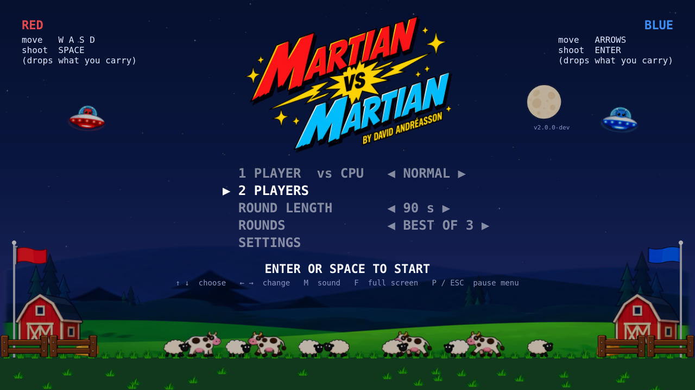
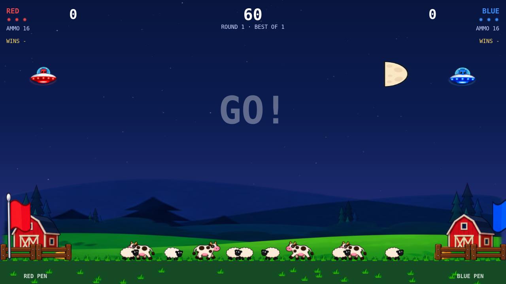
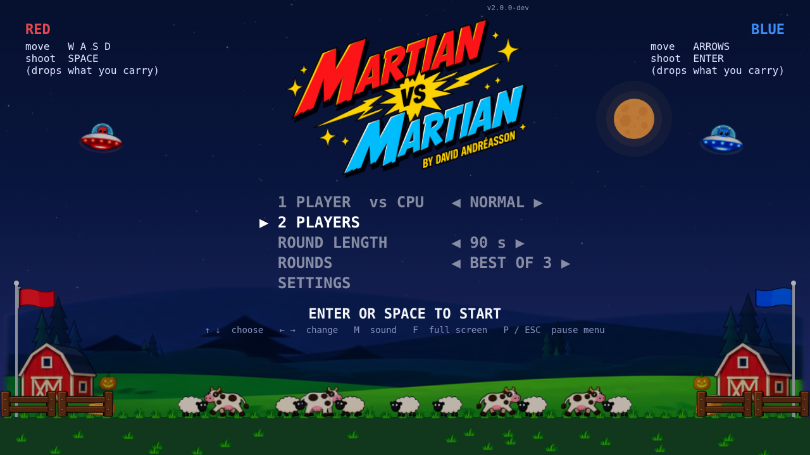
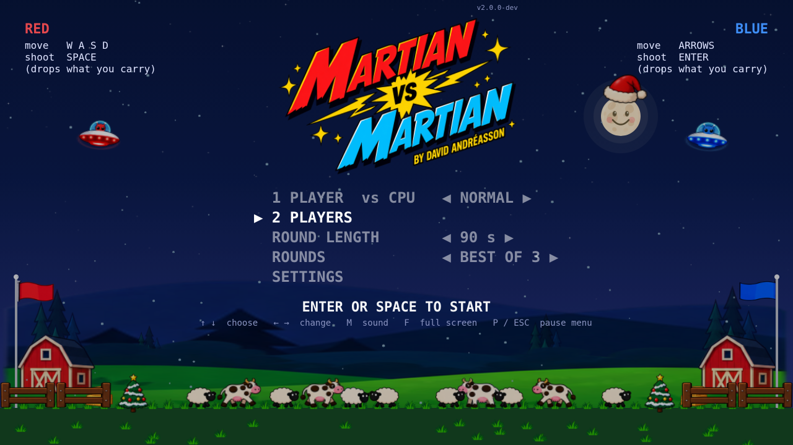

# Phaser sprite review

The `phaser-sprites` branch starts from `phaser` commit `93a86f6` and introduces
83 cartoon frames across four PNG/JSON atlases based on the supplied concept.
Version remains `2.0.0-dev`.

## Try it

```sh
npm ci
npm run dev
```

Cartoon artwork is the default. In **Settings** or the **pause menu**, set
**CLASSIC GRAPHICS: ON** for the original art, or OFF for cartoons. The setting is
saved separately from round options. Switching while paused replaces the visual
views and resumes the same round: time, scores, entities, CPU, match/tally, audio
and controls are retained.

Review URLs can add `?graphics=classic` or `?graphics=cartoon`; these override the
saved choice without writing it. Gallery URLs such as
`?gallery=artwork&graphics=cartoon&art=animals` show controlled poses. Use
`art=icons`, `drops`, `wolves`, `weapons`, `saucers`, `hud` or `arena` for other
families. The original audit gallery stays classic when no graphics parameter is
given. Add `&date=2026-12-24`, `2026-12-31`, `2026-06-19`, `2026-05-04` or
`2026-10-31` for the special-day artwork. `&renderer=canvas` exercises fallback.

## Scenery review revisions

Cartoon flags now use 60 × 34 cloth frames on taller poles at the same mirrored
positions as classic mode. Pen labels and the three-step title instructions are
hidden in cartoon mode. A separate foreground fence layer puts landed animals
behind the rails, and remains part of the frozen round-result view. Classic
scenery and instructions retain their original presentation.
Halloween pumpkins are centered over the illustrated inner fence posts rather
than the pen boundaries. Their positions mirror each other across the arena.
Christmas trees sit entirely outside the pens, on the field side of each gate,
and render after the foreground fences. On December 24 and 25, the moon wears a
hat centered on its white brim and has the same smiling face as classic mode.

The title uses the stacked logo based on the corrected inspiration image, with
both the red and blue words spelled **MARTIAN**, the yellow lightning burst and
author credit. It retains its aspect ratio and fits above the menu in the space
previously used by the instructions.
The version is right-aligned above the logo. Cartoon moons use the classic
64-pixel circular disk and phase geometry, with a faint dark side and two subtle
haze layers. The full-moon atlas texture supplies the craters; it is clipped once
when a view is created, avoiding stretched or misplaced phase sprites and any
per-frame texture painting.

## Coverage

| Existing graphics | Cartoon treatment |
| --- | --- |
| Saucer hulls, pilots, glass, lights | Red/blue saucer and blink frames; original hover, tilt and stun motion |
| Shield, hit flash, aura, streaks, dizzy stars, held weapons and ram front | Atlas overlays animated with transforms and alpha |
| Cows and lambs | Idle, two walk poses and kicking/aloft poses; gold/soot tint, owner marker, bonus star, alarm, parachute and flames |
| Wolves | Walk, eating and howling frames, blood cue and parachute |
| Green men, packages, ammo crates | Alien/panic frames, gift and crate frames, shared parachute; power signs and live text |
| All 13 powerup symbols | Dedicated badge frames used by drops and HUD |
| Shots, rockets, bombs, lasers and time bombs | Sprite pools, rotating/flickering frames and live fuse countdown |
| Tractor beams | Cyan native geometry that follows the exact endpoints, with moving atlas rings |
| Particles, splats, smoke, rings, confetti and shooting stars | Reused tintable atlas slots; existing event schedules, caps and shake |
| Sky, moon, hills, ground, pens and flags | Navy gradient, phased moon frames, hill/meadow tiles, grass, barns, hay, fences and flag sprites |
| Christmas, New Year, Midsummer, May 4 and Halloween | Hat, snowflakes, fireworks, tree, maypole/ribbons, orbital station/fighters, pumpkin and bats |
| Title and HUD | Comic logo, sprite ammo pips and power icons; readable native text and numerical labels |

Text, full-screen veils, solid fills, progress bars and the variable-length beam
plane remain native text/geometry. They need arbitrary values or dimensions;
the illustrations use the supplied sheets. The classic renderers remain available.
No game rules, collision sizes, original options, audio or controller logic changed.

## Rendering and verification

The host preloads four atlases using Vite asset URLs, including under a Pages
subdirectory. Atlas frames are shared by every scene and restored by Phaser after
WebGL context loss. Frame changes, movement, alpha and WebGL tint use native
Images, with pooled effect/projectile objects. Canvas uses a bounded cache of
tinted frame copies. Scene-owned views and style subscriptions are disposed on
switch/exit; the atlas sources remain owned by the Phaser game.

The checks below are recorded in adjacent JSON evidence files:

- All 467 tests pass, including the unchanged 271 original test identities in
  30 files. Preservation checks retain all 48 original source hashes.
- ESLint/Prettier and the production build pass. The existing Phaser chunk-size
  warning remains; source PNGs are excluded from the build.
- 28 cartoon gallery cases and 12 seasonal cases pass in Chromium WebGL/Canvas.
- The real settings choice survives reload. Each renderer passes 25 paused
  switches while retaining the round/session identity and serialized game state,
  with stable object, texture and input-subscription counts.
- Production checks pass eight root/subdirectory, WebGL/Canvas and DPR cases,
  six routing cases, complete match flow, mocked controllers and 80 scene cycles.
- Texture/cache checks cover both renderers at DPR 1/2 and real WebGL context
  restoration at both densities.
- Moon pixel checks cover all four phases in WebGL/Canvas: circular full disk,
  the correct illuminated side and fading haze. Title placement checks cover
  the version in both graphics modes (`moon-review.json`).
- Focused Halloween placement checks pass on the title screen and during play
  in both renderers (`pumpkin-review.json`); build and lint pass for this revision.
- Christmas checks cover December 24/25 and the adjacent dates in both renderers,
  on the title screen and during play. Trees remain outside the pens and in front
  of the fences; hat alignment and visible smile pixels pass. Paused style
  switches preserve round state and input subscriptions (`christmas-review.json`).

Run the relevant checks with Playwright and the existing Python requirements:

```sh
npm test
npm run lint
npm run build
python scripts/phaser/check_sprites.py --base-url http://127.0.0.1:5173/
python scripts/phaser/check_production.py --browser-executable /usr/bin/chromium --software-gpu
python scripts/phaser/check_resources.py --base-url http://127.0.0.1:5173/
python scripts/phaser/check_moons.py --base-url http://127.0.0.1:5173/
```

These automated checks use Chromium and a software GPU. They establish asset
coverage, state preservation, loading and ownership; they do not establish M1
Safari frame pacing. Controller checks are mocked; the controller and sound
services from the accepted `phaser` branch are unchanged.
Review ordinary and busy play on the M1, especially silhouettes, movement, pickup
beams, team colors and explosions. The existing comparison script can target
`?graphics=classic` and `?graphics=cartoon`. Earlier Phaser performance acceptance
and its rare benchmark outliers remain documented in the cutover notes.








